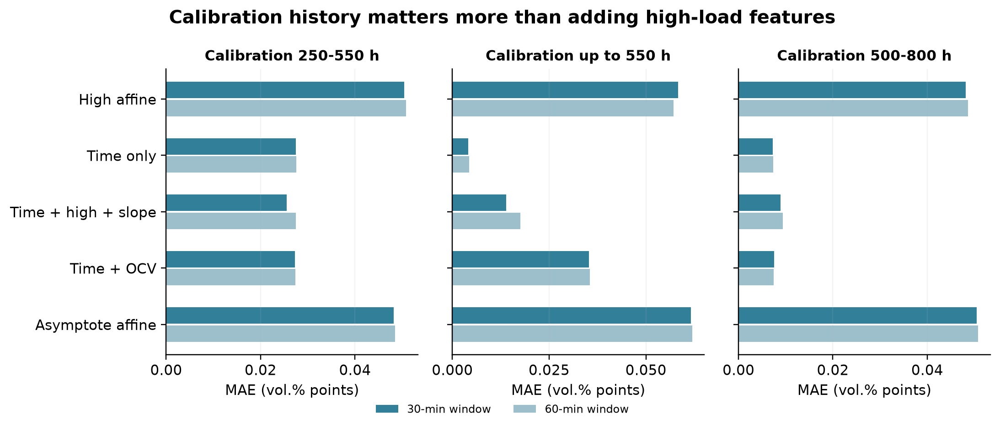
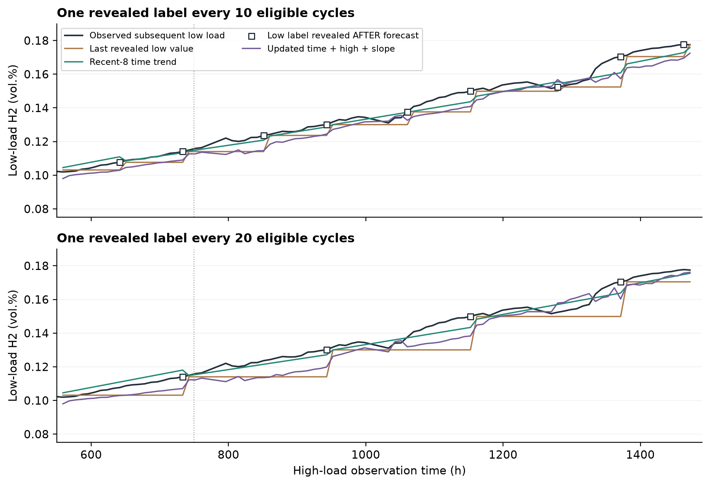
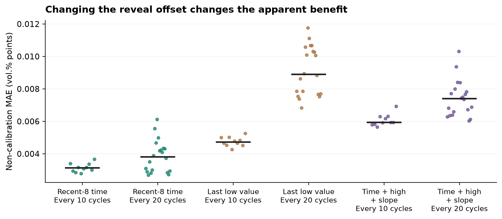
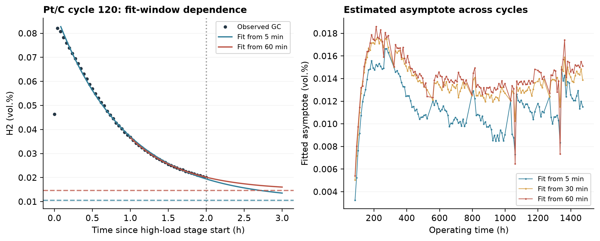
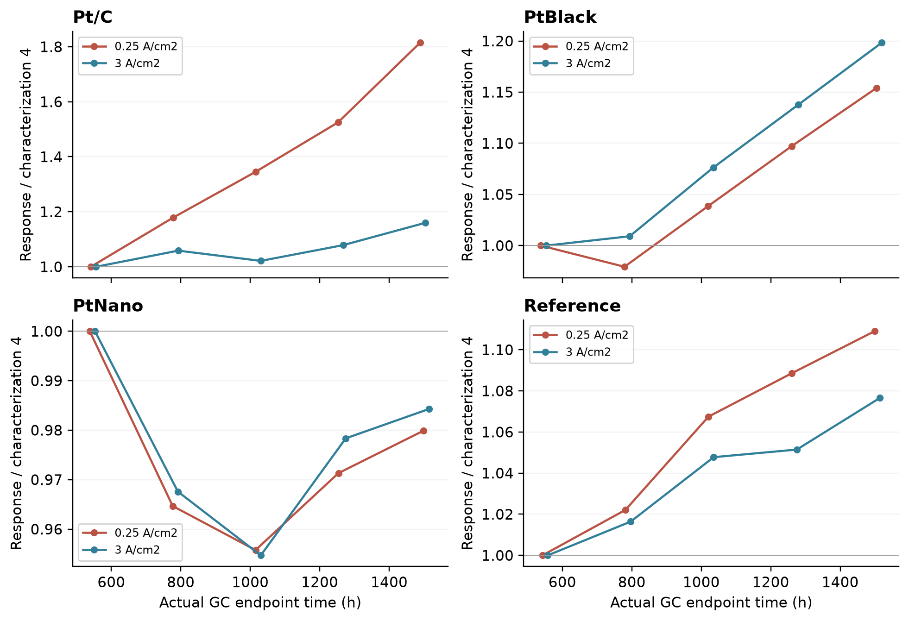

# PEM 水电解跨负载诊断：公开数据方法案例

**作者：JIN HANZHE**  
**单位：Independent Researcher, Chongqing, China**  
**联系：jinhanzhe09@gmail.com**  
原分析日期：2026-10-12；公开整理日期：2026-10-22；本地候选版本：1.0.0-rc.1。

[项目入口](../README.md) · [复现说明](../REPRODUCING.md) · [署名披露](../AUTHORSHIP.md) · [实际验证记录](../VALIDATION.md)

## 一 研究结论与范围

在四个主要膜电极组件（MEA）的公开长期实验中，本研究检验高负载出口氢浓度能否预测随后低负载出口氢浓度。PEM 是聚合物电解质膜；GRC 是气体复合催化剂；GC 是气相色谱；OCV 是开路电压。目标是原作者稀释校正后的阳极出口氢浓度，不是唯一的跨膜通量或复合速率。

Pt/C 的固定高载映射在后期持续低估。运行时间和近期低载观测提供了更强的简单基线，而已测试的高载浓度、斜率和 OCV 特征没有带来稳定的额外增益。公开价值在于展示时间漂移、校准资料范围、揭示顺序和强基线怎样影响诊断结论，适合作为可复现的方法案例。

| 核心问题 | 结果 |
| --- | --- |
| 数据覆盖 | 固定版本 Zenodo 19361280；547 个可配对周期 |
| Pt/C 固定高载映射 | 主分析后期 MAE 0.050421 vol.% 点，绝对相对误差中位数 35.20% |
| 校准资料范围 | 改用 550 h 前全部 46 个周期，纯时间模型后期 MAE 0.004152 |
| 相同标签预算 | 每 10 周期开放一次，近期时间模型 MAE 0.003396；高载增强模型 0.005800 |
| 科学边界 | 每配置一个主要 MEA；回顾性探索；无外部 MEA 确认或成本节省干预 |

MAE 是平均绝对误差。每组只有一个主要 MEA，周期数不能作为独立样品数；配置、批次和操作历史互相混杂。稀疏标签模拟保留了实际实验全部低载保持，因此没有证明减少保持时间、测量次数、能耗或成本。整个研究没有预注册、前瞻验证或独立实验确认。

分析与文字使用 OpenAI Codex 辅助完成。这里的另一套数值实现核查属于同一 AI 辅助流程，不代表外部团队复核。

## 二 数据来源与复现核查

原始数据来自 Brundiers 的固定版本 10.5281/zenodo.19361280，许可 CC BY 4.0。压缩包大小 199357168 字节，MD5 为 b161b3a2eb0d655266bd13618da386a7，与官方元数据一致。包内包含四个 CSV、5 页数据说明及示例笔记本；数据说明不等于期刊完整补充资料。[D1]

| 配置 | 原始行数 | 有效校正 GC 行 | 配对周期 |
| --- | --- | --- | --- |
| Pt/C | 5906897 | 29461 | 137 |
| PtBlack | 6003898 | 30049 | 136 |
| PtNano | 5948728 | 29949 | 137 |
| Reference | 5904798 | 29739 | 137 |
| 合计 | 23764321 | 119198 | 547 |

四组均有 8 轮七点表征，共 224 个负载保持段。GC 观测中位间隔约 140–142 秒；电气原始行不能充当独立气体样本。未发现倒序时间戳。重复电气时间戳和数值相等的真实 GC 记录均保留；压力、电导缺失保持为空。

五个不能配对的周期均缺少高载校正 GC：Pt/C 第 110 周期、Reference 第 109 周期、PtNano 第 137 周期、PtBlack 第 57 和 137 周期。排除清单保留在结果目录。另用标准库 CSV 解析和中位数算法，直接从原始 ZIP 抽查 32 个高低载尾窗，计数与中位数全部一致。该核查是同一分析者采用另一实现完成，不是独立实验或独立研究团队复核。

早期项目报告的主要数值已复现，并查清了一个未写明的时间口径：用随后低载终点划定 250–550 小时，得到 28 个训练周期；用高载预测时间划定同一区间则为 27 个。第 19 周期高载末 GC 为 249.869 小时，低载末 GC 为 254.934 小时，正好跨过边界。

| 口径 | Pt/C 训练数 | Pt/C 后期 MAE | 相对误差中位数 |
| --- | --- | --- | --- |
| 早期项目报告低载终点口径 | 28 | 0.050330 | 34.936% |
| 本阶段高载时间口径 | 27 | 0.050421 | 35.200% |

两种口径的四配置仿射结果均保存在 proposal_reproduction.csv。以下主结果统一采用本阶段高载时间口径，不与早期项目报告 28 周期结果混用。

## 三 预测任务与比较规则

在高载恒流阶段结束时发出预测，目标是随后低载阶段的校正出口氢浓度。每个保持段以最后一个有效 GC 为锚点，向前取 30 分钟中位数；60 分钟作为敏感性检查。高低载末 GC 的时间间隔中位数为 5.043 小时。每个 MEA 独立拟合。

高载为 3 A/cm²，随后低载为 0.25 A/cm²。预测输入只使用高载结束前已发生的浓度、尾段斜率、累计时间、OCV 与等待历史。低载温压、实际终点和保持长度只用于标签或事后质量检查，不进入预测器。电气段末记录近似预测时点，保留最后 GC 至段末的滞后字段。

| 模型族 | 具体规则 | 拟合自由度 |
| --- | --- | --- |
| 浓度基线 | 训练期中位数；低高浓度比中位数；含截距仿射关系 | 常数或 1–2 参数 |
| 时间基线 | 仅用高载末 GC 的累计小时数拟合直线 | 截距和斜率 |
| 有限特征模型 | 时间、高载尾值、斜率或前序 OCV 的有限组合 | 最多 4 个系数含截距 |
| 单指数 | c + A exp(−t/τ)，c、A 非负，τ 为 0.03–100 小时 | 3 个曲线参数 |
| 物理约束检查 | 相同净出口氢流假设；非负截距和斜率的组分比映射 | 0 或 2 参数 |
| 再校准 | 最近标签、累计时间回归、最近 8 标签时间回归及更新高载模型 | 相同标签开放日程 |

单变量回归使用普通最小二乘。多特征回归仅用训练数据填补特征缺失和标准化，固定岭回归系数为 1，不在测试集上调参。额外等待历史模型是首轮结果之后的敏感性检查，已记录分析补充，不冒充预先设定的主分析。

主训练区间为 250–550 小时，评价 750 小时后的 70 个周期，并拆成 750–1100 小时和 1100 小时以后两块。另比较 0–550 小时训练，以及 500–800 小时训练、1000 小时以后评价。所有区间均来自已经被探索的公开数据。

主要指标是平均绝对误差 MAE，单位 vol.% 点；另报绝对相对误差中位数、带符号偏差和 RMSE。配对移动分块重采样使用 5 周期及 10 周期两个长度，给出本条轨迹的描述性百分位区间，不代表跨 MEA 总体置信区间。

## 四 固定高载映射的适用边界

图 1 Pt/C 逐周期预测。浅蓝为主校准区间，浅黄为主要评价区间。绿色虚线使用更早的全部 46 个周期；其校准资料范围与其他实线不同，不能将差异解释为单纯模型结构效应。下图的拟合渐近值不等于实测稳态。

| 配置 | 后期周期 | 仿射 MAE | 相对误差中位数 |
| --- | --- | --- | --- |
| Pt/C | 70 | 0.050421 | 35.20% |
| PtBlack | 70 | 0.047079 | 9.93% |
| PtNano | 70 | 0.016214 | 0.715% |
| Reference | 70 | 0.311585 | 3.95% |

Pt/C 的全部 70 个后期预测均低于实测值。两个后期时间块的 MAE 分别为 0.03367 和 0.06537 vol.% 点，方向一致且后块更大。其他配置并不共享相同误差结构；这些误差不是材料性能排名。

## 五 瞬态特征没有稳定超越时间基线

图 2 Pt/C 不同校准区间和 30、60 分钟尾窗的模型比较。前两组评价相同的 70 个后期周期；最后一组评价 1000 小时以后的 45 个周期。

| 训练范围 | 时间模型 MAE | 时间加高载和斜率 MAE | 相对时间模型变化 |
| --- | --- | --- | --- |
| 250–550 h | 0.027502 | 0.025490 | 误差降低 7.3% |
| 0–550 h | 0.004152 | 0.013875 | 误差增加 234.2% |
| 500–800 h | 0.007297 | 0.008875 | 误差增加 21.6% |

主切分的 7.3% 改善远低于本项目设置的 30% 资源投入门槛。5 周期分块重采样给出的改善百分位范围约 5.0%–9.0%，只是当前单条轨迹的稳定性描述。使用更早的校准数据后，纯时间模型的相对误差中位数为 3.32%，高载特征反而降低预测质量。

有限 OCV 特征、只用高载斜率、单指数渐近值及等待历史检查均未产生稳定的额外优势。不能把“比失效的高载仿射模型好”写成相对最强简单基线的增益，也不能由此宣称任何复杂模型都无效；结论限于已测试的低维模型族。

简单物理检查同样不能替代测量。若假设两种负载净出口氢摩尔流相同、氧生成按电流比例变化，则组分比 r = y/(100−y) 满足 r低 = 12 r高。此条件模型在 Pt/C 后期 MAE 为 0.08142。允许非负背景项和斜率后，MAE 约 0.05042。它们是条件假设下的诊断基线，不是对真实跨膜通量或复合速率的反演。

## 六 稀疏低载观测的价值

图 3 Pt/C 在线模拟。方框对应本轮预测完成后才开放的低载标签；750 小时之前的开放标签也消耗预算。所有方法共享日程和初始可用标签。

| 方法 | 每 10 周期 MAE | 每 20 周期 MAE |
| --- | --- | --- |
| 最近 8 个已知低载的时间回归 | 0.003396 | 0.003100 |
| 最近一次低载持续值 | 0.005007 | 0.007855 |
| 更新的时间加高载和斜率 | 0.005800 | 0.006280 |
| 更新的高载仿射关系 | 0.043869 | 0.048237 |

主切分初始可用 27 个标签，之后有 91 个可预测周期；两种日程分别再开放 9 和 4 个标签。750 小时后用于主要评分的未校准周期数分别为 63 和 67。全程先预测，再揭示标签；校准轮的揭示前误差也另存。

同预算下，高载增强模型比近期时间基线的 MAE 高 70.8% 和 102.6%。5 周期分块重采样的误差差值区间也位于正侧。新增低载信息有用，但本结果主要支持近期低载趋势更新，尚未证明高载诊断提供了必要信息。

## 七 校准时点与配置差异

图 4 每种间隔遍历全部可能的首次开放偏移。点表示不同日程的结果，横线是其中位数；不是独立 MEA 的重复试验。

不能因为默认日程下每 20 周期的数值略低，就断言更少标签更好。近期时间模型在全部偏移下，每 10 周期的 MAE 中位数为 0.003125，范围 0.002787–0.003665；每 20 周期中位数为 0.003808，范围 0.002683–0.006119。日程与原表征扰动的位置关系会改变结果。

两种默认日程在共同 63 个未校准周期上的 MAE 为 0.003396 和 0.003138；该结果仍只是这一个默认偏移，不是最优校准频率证据。校准间隔没有根据后期误差重新选择。

| 配置 | 最近低载持续值 | 近期时间模型 | 时间加高载和斜率 |
| --- | --- | --- | --- |
| Pt/C | 0.005007 | 0.003396 | 0.005800 |
| PtBlack | 0.006091 | 0.007503 | 0.015954 |
| PtNano | 0.015014 | 0.021153 | 0.014522 |
| Reference | 0.060020 | 0.044961 | 0.060300 |

表为主切分、30 分钟窗口、每 10 周期开放一次的未校准周期 MAE。近期时间模型并非在所有配置中最好。Pt/C 与 Reference 同批，另两组另批；配置与批次混杂，每配置一个主要 MEA，所以不拟合材料总体效应，不把四条曲线当作某种材料的四个独立重复。

本模拟保留原始实验的全部低载保持和操作历史，只限制模型能看见哪些标签。它没有实际减少 GC 测量次数、低载时长、能耗或实验成本。

## 八 动态参数受模型形状影响

图 5 同一高载序列使用不同起始窗口拟合。左图两小时后的线段是模型外推，没有新的实测点；水平虚线表示拟合渐近值。右图展示全周期敏感性。

Pt/C 后期高载尾段浓度中位数为 0.01917 vol.%，尾段斜率中位数为 −0.00885 vol.% 点每小时。因此高载尾值不能自动称为稳态值。单指数常能很好拟合已观测的下降段，但高拟合优度不保证渐近值是材料真实属性。

| 拟合起点 | 后期渐近值中位数 | 时间尺度中位数 | 剖面判据通过 |
| --- | --- | --- | --- |
| 高载后 5 分钟 | 0.010995 vol.% | 0.719 h | 70/70 |
| 高载后 30 分钟 | 0.013115 vol.% | 0.607 h | 69/70 |
| 高载后 60 分钟 | 0.013727 vol.% | 0.568 h | 67/70 |

5 分钟与 60 分钟起拟合的渐近值中位数相差约 25%。这说明“指定指数族内可识别”与“跨拟合窗口稳定”是不同问题。局部剖面范围忽略了模型形状误差，也没有分离气路库存、化学复合、膜传输及电化学消耗。

计算的剖面集合定义为 SSE 不超过该曲线最小值的 1.10 倍，要求时间尺度范围比不超过 3、渐近值跨度不超过观测中位数的 20%、且不触及约束边界。这只是预设启发式判据，不是置信区间。PtNano 多数曲线不符合正幅度下降指数，达到边界的结果被标记，不能解释为真实的极快时间常数。

另外保留了仅用高载前 1 小时拟合、预测后 0.5 小时的内部形状检查。它评价的是高载波形短时外推，不能充当跨负载或外部 MEA 验证。现阶段不输出真实氢跨膜通量、GRC 复合速率常数或唯一老化机制。

## 九 稳健性与负载响应

图 6 每组、每负载用第 4 次表征的 r = y/(100−y) 归一化。横轴采用各负载实际末 GC 时间；七点表征固定升流且历时不同，各点并非同时测量。各面板纵轴范围不同，不能凭线条视觉斜率比较材料。

| Pt/C 检查 | 结果 |
| --- | --- |
| 尾窗 30 与 60 分钟 | 仿射 MAE 分别 0.050421 和 0.050782；两个后期块均持续低估。 |
| 仅高载已知质量条件 | 保留 69 个后期周期，MAE 0.050759。 |
| 再加低载事后温压和长度 | 保留 67 个，MAE 0.051053；不可当作预测时可执行的筛选。 |
| 只保留紧接前序 OCV 的周期 | 训练 26、评价 67，重新拟合后 MAE 0.049818。 |
| 第 4 至第 8 次表征增长 | 低载与高载增长倍数之比 1.5649；60 分钟窗口为 1.5569。 |

质量规则为高载压力 29.5–30.5 bar、尾段块体温度距训练中位数不超过 2 °C、GC 跨度至少 1 小时且尾窗至少 4 点；事后低载检查增加同类温压限制和至少 3 小时 GC 跨度。阈值不是设备安全标准。结果降低了明显异常解释全部失配的可能性，但没有测量内部温度或消除所有历史依赖。

## 十 测量误差与文献范围

原始数据包没有提供足够信息来核定本装置的长期 GC 漂移、低浓度检出限、定量限、标准气重复性和气路阶跃响应。五页数据说明不能替代期刊完整补充资料。2026-10-12 的研究阶段未取得完整期刊补充材料；本次公开整理没有补做完整的文献系统综述。不能据此断言原作者未报告这些信息，也不宣称本项目首次提出相关诊断思想。

数据说明记载 Agilent 990 microGC 及氧气稀释安排。Pt/C 后期低载校正浓度与原始读数之比中位数约 7.008。主仿射模型低估中位数 0.05186 vol.% 点；若只用低载通道加性漂移解释，等价于未校正读数约 74 ppm 的偏移。这是量级换算情景，不是实测漂移，也不是允许误差。

低载尾窗标准差中位数约 0.000430 vol.% 点，虽小于映射误差，但同一保持段内波动不能约束跨月系统漂移或稀释系数偏差。因此，本报告将定量测量意义保留为未核定，而不把统计失配直接升级为材料机理证明。

## 十一 可公开的判断与后续验证条件

本研究已经形成可检查的公开数据案例：固定高载映射在这条 Pt/C 轨迹的后期失效；较好的简单基线需要充分比较；揭示低载标签的预算和时点必须相同；拟合形状与物理解释应分开。

30% 改善是本项目预设的资源投入门槛，不是学科公认标准或统计显著性界限。主切分高载增强只有约 7.3% 改善，改变校准区间后又失去优势，所以当前结果不支持仅靠增加模型复杂度继续扩大该路线。结论限于测试过的低维模型族。

如要提出超出本案例的结论，首先需要本试验的校准、漂移和气路响应资料，以及新的独立 Pt/C MEA。一个新 MEA 也只能构成个案确认，不能证明材料总体规律。若要声称节省低载保持时间，应另做实际改变保持协议的实验，并验证气路恢复和测量一致性。本报告没有给出设备运行安全阈值。

## 十二 复现入口与引用

根目录 [reproduce.py](../reproduce.py) 提供快速核查、整理数据重跑和原始数据完整重建三层入口。各层均写入新目录，详见 [REPRODUCING.md](../REPRODUCING.md)。本次实际执行范围、数据比对和限制见 [VALIDATION.md](../VALIDATION.md)。

主时间划分使用高载末次 GC 的 `time_h`；高载操作段终点 `forecast_h` 用于表示预测发出时点。原方案的低载终点切分另存，不能混用 27 与 28 个训练周期的数值。初始规则和事后补充分别保留；执行模型清单与历史规则的差别见 [公开整理变更](../provenance/PUBLIC_CHANGES.md)。

文内结果基于固定分析，不随未来数据变化自动更新。改变方法后应重新检查表格、图和解释。图表用原数据生成，不能归属于上游论文作者的新结论。

**D1** Brundiers S. *Datasets: Time-Resolved Performance and Stability of Different Gas Recombination Catalysts in PEM Water Electrolysis*. Zenodo, 2026. [10.5281/zenodo.19361280](https://doi.org/10.5281/zenodo.19361280)。

**R1** Brundiers S, Trinke P, Geiger S, Gracia-Medrano-Bravo VA, Hubka M, Ilsemann J, Bensmann B, Hanke-Rauschenbach R. *Time-resolved performance and stability of different gas recombination catalysts in PEM water electrolysis*. EES Catalysis, 2026. [10.1039/D6EY00106H](https://doi.org/10.1039/D6EY00106H)。

本文、图表及派生数据按 CC BY 4.0 提供；原创软件采用 MIT。保留 JIN HANZHE 与上游实验作者的相应署名，并注明后续改动。完整许可范围见 [LICENSING.md](../LICENSING.md)。
