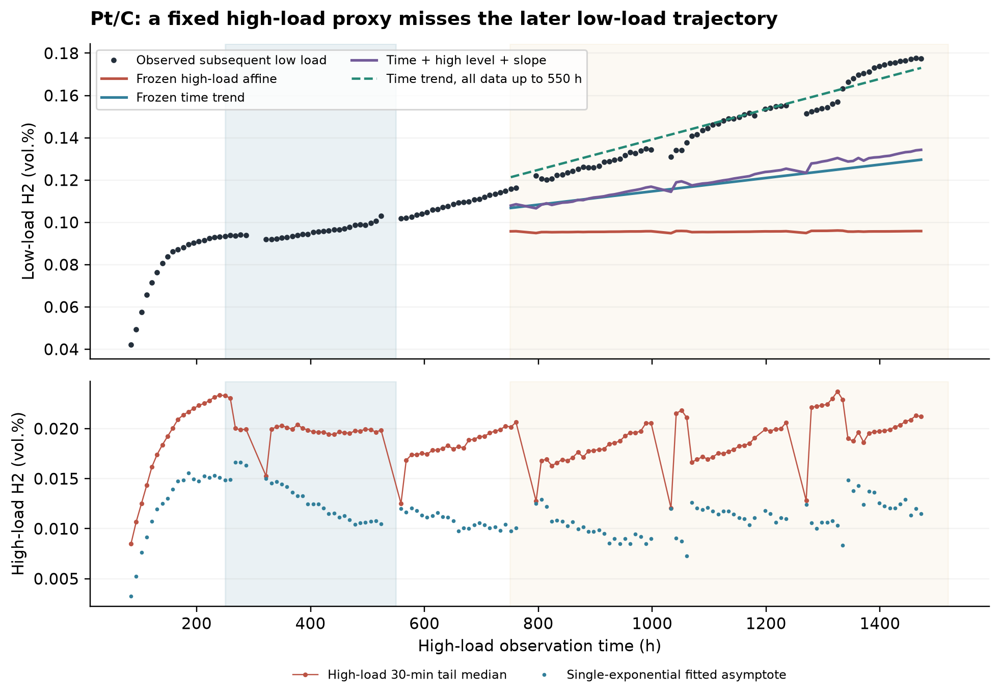

# PEM 水电解跨负载预测与再校准审计

**JIN HANZHE · Independent Researcher, Chongqing, China**  
项目代号：GRC_LoadTransfer_01 · 本地发布候选：1.0.0-rc.1 · 整理日期：2026-10-22  
[English](README.en.md) · [中文研究报告](06_report/中文研究报告.md) · [复现说明](REPRODUCING.md) · [验证记录](VALIDATION.md) · [引用](CITATION.cff)

本项目用公开的 PEM 水电解长期实验数据，检验“高负载时的出口氢浓度，能否预测随后低负载的出口氢浓度”。PEM 指聚合物电解质膜；GRC 指气体复合催化剂。项目的公开价值是展示时间漂移、基线选择、校准资料范围和标签开放时点怎样改变结论。

**主要结果：Pt/C 的固定高载映射在后期持续低估；增加高载特征没有稳定胜过简单时间基线。** 近期低载观测能改善这条轨迹内的预测，但这里的模拟只隐藏标签，保留了全部实际低载保持，不能据此声称减少了实验成本或能耗。

## 数据与结果

数据来自 [Steffen Brundiers 的固定版本 Zenodo 19361280](https://doi.org/10.5281/zenodo.19361280)，采用原作者稀释校正后的阳极出口氢浓度。四种配置各有一个主要膜电极组件（MEA），共 547 个配对周期。**周期数不等于独立样品数**，不能用四组结果推断材料总体排名。

主分析以高载末次气相色谱（GC）观测时间划分：250–550 h 校准，750 h 以后评价；Pt/C 分别为 27 和 70 个周期。高载为 3 A/cm²，低载为 0.25 A/cm²，终点取末次 GC 前 30 分钟中位数。平均绝对误差（MAE）单位是 vol.% 点。

| Pt/C 比较 | MAE | 解释 |
| --- | ---: | --- |
| 固定高载仿射模型，主切分 | 0.050421 | 70 个后期预测均低估 |
| 固定时间模型，主切分 | 0.027502 | 与上行使用相同校准周期 |
| 时间加高载和斜率，主切分 | 0.025490 | 相对时间模型仅改善约 7.3% |
| 固定时间模型，改用 0–550 h 的 46 个周期 | 0.004152 | 校准资料范围改变，不能归因于模型结构 |
| 近期 8 标签时间模型，每 10 周期开放一次 | 0.003396 | 同预算下评估 63 个未校准周期 |
| 更新的时间加高载和斜率，同一日程 | 0.005800 | 高载特征未提供额外优势 |

每次先预测，再开放当前低载标签。改变首次开放时点会改变结果，默认每 20 周期的较小误差不代表最优校准频率。完整比较见[中文报告](06_report/中文研究报告.md)。

## 三层复现入口

使用 Python 3.12，在解压后的项目根目录运行。每次生成一个新目录，不覆盖随包保存的结果。

| 层次 | 命令 | 实际完成的工作 |
| --- | --- | --- |
| 快速核查 | `python reproduce.py` | 仅标准库；核验文件散列、重算保存预测的评分、检查时序和标签预算 |
| 重跑分析 | `python reproduce.py --mode analysis` | 安装依赖后，从随包整理数据重新拟合模型、敏感性和六张图，运行 5 项因果时间检查 |
| 原始重建 | `python reproduce.py --mode full --download` | 下载并校验固定原始 ZIP，从 23,764,321 行数据重建全部派生表，再重跑分析及 32 个原始尾窗抽查 |

有原始包时，可用 `--mode full --raw-archive "原始包路径.zip"` 离线重建。约 199 MB 的原始 ZIP 和约 106 MB 的 OCV 明细不随仓库分发；原始重建会自动生成所需明细。**快速核查不等于重新训练；分析层不等于重新提取原始数据。** 安装、输出位置和数值容差见 [REPRODUCING.md](REPRODUCING.md)。

## 适用范围

这是已探索数据上的回顾性方法案例，没有预注册、前瞻性试验或外部 MEA 确认。四条轨迹与操作批次、实验顺序混杂。分块重采样只描述当前轨迹内的变化；指数拟合参数也不是唯一物理机制。

原始包不足以核定本装置的长期 GC 漂移、检出限及校准误差。2026-10-12 的研究阶段未取得完整期刊补充材料；本次公开整理没有补做完整文献系统综述，不能把这个状态写成原作者未报告相关信息。结果不构成设备安全控制验证，也不证明高载测量可独立替代低载测量。

## 文件入口

| 位置 | 内容 |
| --- | --- |
| `00_admin/` | 2026-10-12 的分析规则、补充记录及历史环境 |
| `01_raw/` | 官方元数据快照及上游数据说明的文本转录 |
| `02_processed/` | GC 明细、操作段、周期、表征终点和数据字典 |
| `03_analysis/`、`tests/` | 保留原算法的分析代码和因果时间检查 |
| `04_results/`、`05_figures/` | 冻结预测、分数、敏感性、六张 PNG/SVG 图 |
| `06_report/` | 更新署名和相对路径的中文研究报告 |
| `provenance/` | 上游许可与校验记录、原始分析文件散列、公开整理变更说明 |
| `validation/` | 本次实际验证的可读摘要和机器记录 |

## 署名、许可与引用

作者与联系人为 **JIN HANZHE**，邮箱 jinhanzhe09@gmail.com。来源检查、分析、起草和公开整理使用 OpenAI Codex，AI 不列为作者；不声称已完成人工逐项科学核查或独立团队复核。完整披露见 [AUTHORSHIP.md](AUTHORSHIP.md)。

原创软件采用 [MIT](LICENSE)；本项目文档、图表及派生数据采用 [CC BY 4.0](LICENSE-CC-BY-4.0.txt)。原始实验数据的权利和署名归上游作者，详见 [LICENSING.md](LICENSING.md) 与 [THIRD_PARTY_NOTICES.md](THIRD_PARTY_NOTICES.md)。使用本分析时，请同时引用本项目、[数据 DOI](https://doi.org/10.5281/zenodo.19361280) 和[原始论文](https://doi.org/10.1039/D6EY00106H)。本候选版尚未发布到 GitHub，没有公共仓库地址或本项目 DOI。

